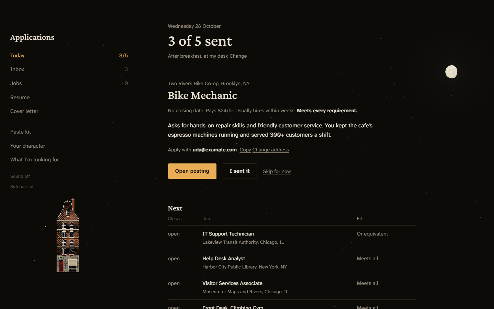
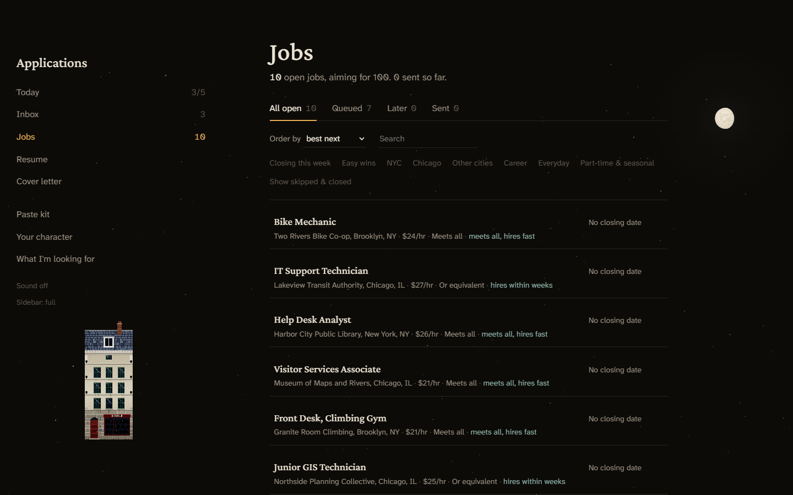
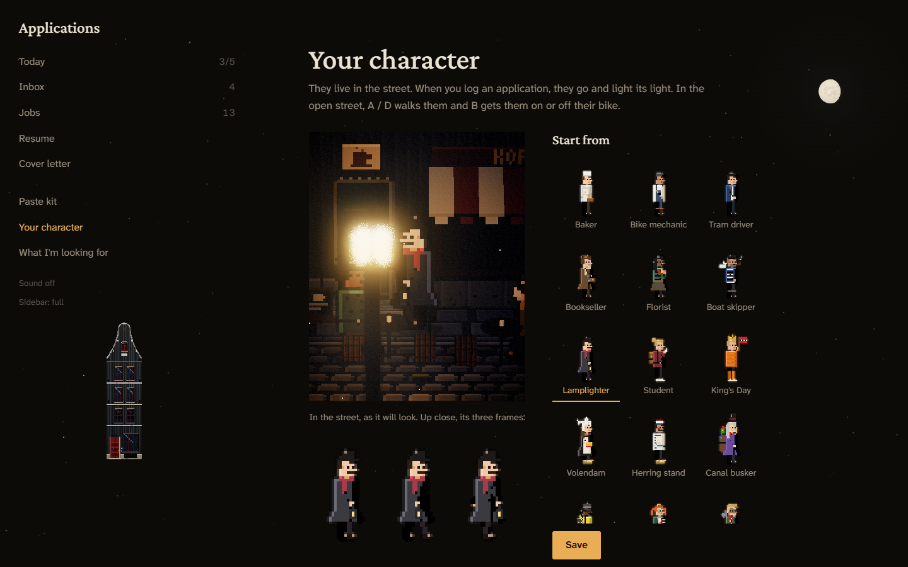

<p align="center"></p>

<h1 align="center">Lamplight</h1>

<p align="center">A job-application tracker where every application you send lights a light in a little Amsterdam street at night.</p>


A job-application tracker that runs on your own computer. Claude finds jobs that fit what you want, the tracker keeps them in order, builds a one-page resume for each one, and every application you send lights a light in a small Amsterdam canal street at night. It's built to make applying a little every day easy to start and hard to drop.

- **Your data stays on your computer.** No account, no server, no tracking. Everything personal is in the `data/` folder.
- **No API key.** Claude helps through your own Claude account: a scheduled task on a paid plan, or a copy-and-paste on the free plan.
- **No fake progress.** Nothing lights up unless you really sent something.

## Set it up

### 1. Install two free programs
- **Python 3.12 or newer**: [python.org/downloads](https://www.python.org/downloads/).
  - Windows: in the installer, tick **Add python.exe to PATH**.
  - Mac: the python.org installer is fine.
  - Linux: usually already there; check with `python3 --version`.
- **LibreOffice** (makes the resume PDFs): [libreoffice.org/download](https://www.libreoffice.org/download/).

### 2. Get the tracker
- On GitHub, press **Code**, then **Download ZIP**, and unzip it somewhere you'll keep it (for example your Documents folder).

### 3. Install its two Python parts
Open a terminal in the unzipped folder and run:
```bash
python -m pip install -r requirements.txt
```
(On a Mac or Linux, use `python3` instead of `python`.)

### 4. Open it
- **Windows:** double-click `Apply.bat`.
- **Mac:** double-click `Apply.command`. The first time, macOS may refuse to open it: right-click it, choose **Open**, then **Open** again. If it says it isn't executable, run `chmod +x Apply.command` in a terminal in the folder once.
- **Linux:** run `./apply.sh` (or `chmod +x apply.sh` first).

Your browser opens at `http://localhost:8765`. The first time, a short setup asks:
1. your name and email;
2. which Claude plan you have;
3. how many applications a day, and when;
4. your resume: Claude turns it into a library the resume builder picks from. It copies your wording; it doesn't rewrite it.

Then comes **the job interview**: about 15 minutes of questions on what you'd love, what you'd take, what you'd never do, and how far to reach. Claude turns your answers into the instructions your job search follows. Every job it finds is marked **ideal**, **good** or **fallback**.

### 5. Getting jobs in
- **Claude Pro or higher:** the end of the interview shows a prompt. In the Claude desktop app, open **Scheduled tasks**, create a daily task with that prompt, and run it once. It fills your Inbox every morning while the app is open.
- **Free plan:** on the **Inbox**, use **Find jobs with Claude**:
  1. copy the prompt;
  2. paste it into a new chat at claude.ai;
  3. paste Claude's answer back.

  That's a batch of about 12 jobs, each checked before it's added.
- **Job alerts:** set up alerts on LinkedIn, Indeed, USAJobs or governmentjobs.com. When one arrives, select all of the email, copy, and paste it into the **Job-alert emails** box on the Inbox. Its jobs land unchecked, and your next Claude batch checks them first.

## What it looks like

| Today: the next job, and one button when you've sent it | Your jobs, best next first |
|---|---|
|  |  |

**Your character** lives in the street and lights each new light. Start from one of 16 townsfolk, then change anything; the preview is the real street.




*Screenshots show a demo person with made-up jobs and employers.*

## Everyday use
- **Today** shows the next job, the resume to use, and a button for when you've sent it.
- **Your character** lives in the street. When you log an application, they go and light its light.
  - In the open street (click the house in the sidebar): **A / D** walk, **B** gets on the bike, **W / S** pan, **↑ / ↓** tilt, **← / →** turn, the wheel zooms, **Esc** closes.
- **Resume** and **Cover letter** build a one-page resume and a short letter for a job, from your own words, and make the PDFs.
- **Sidebar: full / slim / menu only** (under Sound) makes the sidebar smaller.

## If something's off
- **The page won't open:** the little server isn't running. Open it again (step 4). To see an error, run `python app/server.py` in a terminal in the folder.
- **"LibreOffice isn't installed":** install it (step 1), then try again.
- **The street doesn't show:** it needs a browser with WebGL2 (any recent Chrome, Edge, Firefox or Safari). Without it, a simpler drawing is shown.

## Credits
- three.js 0.160.0 (MIT), in `tracker/vendor/three/` with its LICENSE.
- Sounds: real field recordings, in `tracker/sounds/`:

| File | Recording | By | License |
|---|---|---|---|
| `bike-bells-dutch.mp3` | Dutch bike bells, Voorburg | HullMusic, [Freesound 534632](https://freesound.org/people/HullMusic/sounds/534632/) | CC0 |
| `tram-leidsestraat.mp3` | Tram bell and atmosphere around the Leidsestraat | hz37, [Freesound 792486](https://freesound.org/people/hz37/sounds/792486/) | CC0 |
| `canal-night-herengracht.ogg` | Herengracht / Utrechtsestraat, 30 Nov 2014 | Fritz Schlüter, [radio aporee / Internet Archive](https://archive.org/details/aporee_29311_33732) | [CC BY 3.0](https://creativecommons.org/licenses/by/3.0/) |
| `westertoren.ogg` | The Westertoren's half-hourly tune (Geluid van Nederland) | lottebelice, [Wikimedia Commons](https://commons.wikimedia.org/wiki/File:Baantjer_Westertoren_at_Westerkerk_-_SoundCloud_-_lottebelice.ogg) | [CC BY-SA 3.0](https://creativecommons.org/licenses/by-sa/3.0/) |
| `street-night.mp3` | Amsterdam at night, a quiet street around 1 AM | Yuval, [Freesound 191451](https://freesound.org/people/Yuval/sounds/191451/) | CC0 |

## Licence
GPL-3.0: see [LICENSE](LICENSE). The sounds keep their own licences (above), and three.js keeps its MIT licence.
